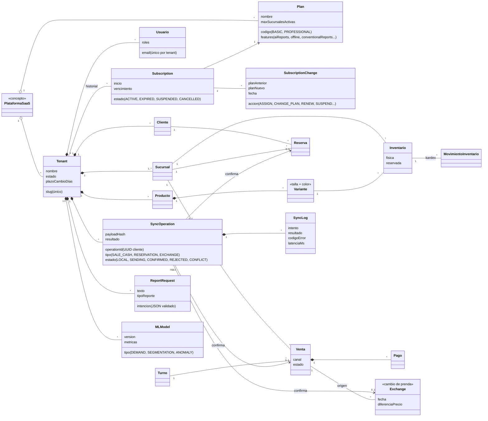
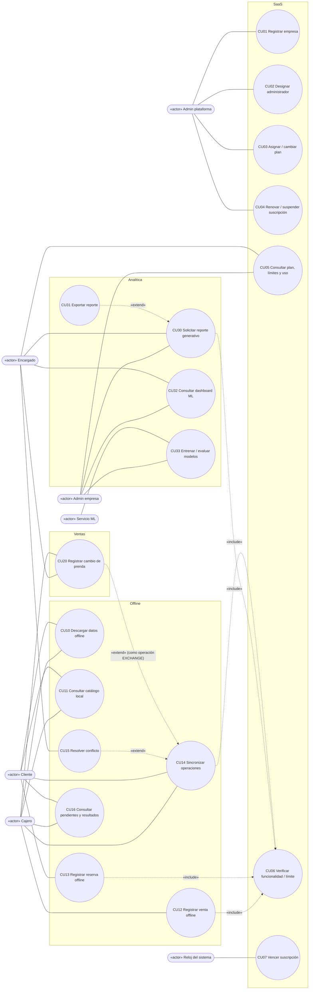
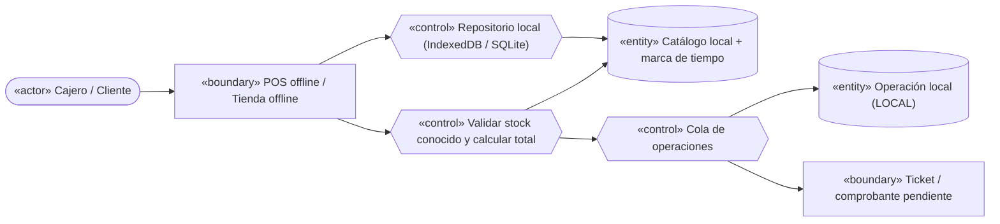
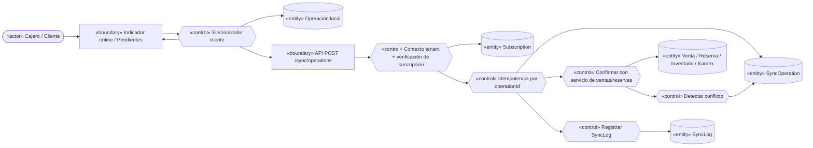
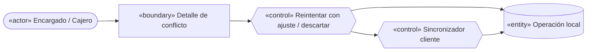
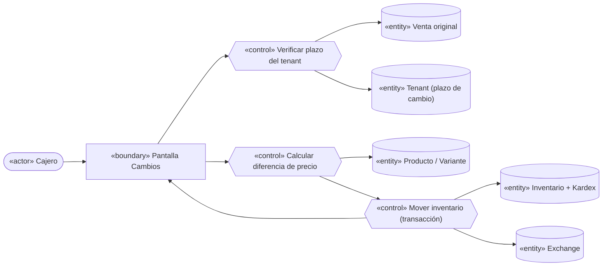
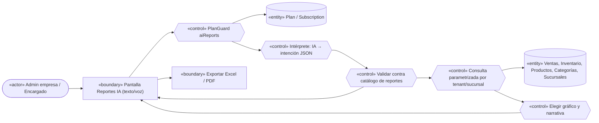
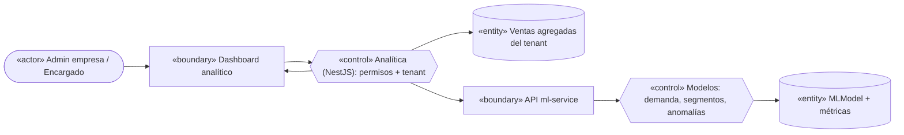

# FashionStore — Modelos ICONIX / UML 2.5+ (segundo parcial)

> Documento único de análisis y diseño del parcial 2 (ver `PLAN_PARCIAL2.md`, sección 7).
> ICONIX se aplica **solo a lo nuevo o modificado** respecto del parcial 1: SaaS multitenant,
> planes y suscripciones, operación offline con sincronización, cambios de prendas, reportes
> generativos y analítica con Machine Learning.
>
> Los diagramas usan **Mermaid**. Mermaid no tiene notación nativa de casos de uso ni de robustez,
> por eso se representan con `flowchart` y estereotipos en el texto de cada nodo
> (`«actor»`, `«boundary»`, `«control»`, `«entity»`). Las secciones marcadas *(análisis)* describen
> el diseño acordado antes de codificar; se revisan en F12 contra lo realmente implementado (RNF12).

Índice

1. [Modelo de dominio](#1-modelo-de-dominio-análisis) (F1.1)
2. [Modelo de casos de uso](#2-modelo-de-casos-de-uso-análisis) (F1.2)
3. [Descripción de casos de uso críticos](#3-descripción-de-casos-de-uso-críticos-análisis) (F1.3)
4. [Diagramas de robustez](#4-diagramas-de-robustez-análisis) (F1.4)
5. Diagramas de secuencia (F12.1) — *pendiente*
6. Diagrama de clases de diseño y modelo de datos (F12.2) — *pendiente*
7. Componentes y despliegue (F12.3) — *pendiente*
8. Matriz de trazabilidad (F12.4) — *pendiente*

---

## 1. Modelo de dominio *(análisis)*

Decisión de base (enunciado 9.2): **una base PostgreSQL compartida con aislamiento lógico**.
Cada empresa contratante es un `Tenant`; una sucursal **no** es un tenant. Toda entidad de negocio
pertenece exactamente a un tenant. Las entidades del parcial 1 se conservan y solo se muestran las
relaciones que cambian o se agregan.

Reglas del dominio:

- `Usuario.tenant` es obligatorio salvo para el **administrador de plataforma** (rol
  `PLATFORM_ADMIN`), que no pertenece a ninguna empresa.
- Los nombres únicos del parcial 1 (categoría, talla, color, proveedor, sucursal por ciudad, email)
  pasan a ser únicos **dentro** de cada tenant.
- Una empresa tiene a lo sumo una suscripción vigente; las anteriores quedan como historial.
- Los límites y funcionalidades viven en `Plan` (datos configurables), no en el código.
- `SyncOperation.operationId` es único por tenant: es la clave de idempotencia (RNF05).

## 2. Modelo de casos de uso *(análisis)*

Actores: **Administrador de plataforma**, **Administrador de empresa** (rol `ADMINISTRATOR` del
parcial 1, ahora acotado a su tenant), **Encargado de sucursal**, **Cajero**, **Cliente**,
**Servicio ML** (actor sistema) y **Reloj del sistema** (vencimientos).

Casos del parcial 1 que se **modifican**: iniciar sesión (ahora por empresa), registrar cliente
(por empresa), CRUD de sucursales (límite del plan), toda escritura de negocio (bloqueada en solo
lectura), reportes convencionales y POS (restringidos al tenant).

## 3. Descripción de casos de uso críticos *(análisis)*

### CU01 Registrar empresa
- **Actor:** Admin plataforma. **Precondición:** sesión de plataforma.
- **Flujo básico:** 1) El admin abre "Empresas" y elige "Nueva". 2) Ingresa nombre, slug, plan,
  fecha de inicio/vencimiento y datos del administrador de empresa. 3) El sistema valida que el slug
  no exista y que el plan esté activo. 4) Crea el tenant, su suscripción `ACTIVE`, el registro de
  historial `ASSIGN` y el usuario administrador con rol `ADMINISTRATOR` dentro del tenant.
  5) Muestra la empresa con su estado.
- **Alternativos:** 3a) Slug repetido → mensaje "el código de empresa ya existe". 3b) Plan
  inexistente o inactivo → error de validación. 4a) Falla cualquier paso → se revierte todo
  (transacción).

### CU03 Asignar / cambiar plan
- **Actor:** Admin plataforma.
- **Flujo básico:** 1) Selecciona empresa y nuevo plan. 2) El sistema compara el uso actual con los
  límites del nuevo plan (sucursales activas). 3) Actualiza la suscripción vigente y agrega
  `CHANGE_PLAN` al historial. 4) Las funcionalidades se habilitan/deshabilitan inmediatamente.
- **Alternativos:** 2a) El uso excede el nuevo límite (p. ej. 5 sucursales activas → Básico) →
  se rechaza indicando cuántas sucursales desactivar.

### CU12 Registrar venta offline
- **Actor:** Cajero. **Precondición:** turno abierto con conexión y datos offline descargados.
- **Flujo básico:** 1) Sin conexión, el cajero busca productos en el catálogo local. 2) Elige
  variantes y cantidades; el sistema valida contra el stock conocido. 3) Registra efectivo recibido.
  4) El sistema guarda la venta local con `operationId` UUID, tenant, sucursal, usuario, cliente
  opcional, fecha local, líneas con precios usados, total, forma de pago y estado `LOCAL`.
  5) Emite el ticket local marcado "pendiente de confirmación".
- **Alternativos:** 2a) Cantidad mayor al stock conocido → advertencia (se permite si la empresa lo
  configura; el servidor decide al sincronizar). 1a) Datos con más de N horas → aviso de "datos
  desactualizados". 4a) Cierre de la app → la venta permanece en almacenamiento local (RNF03).

### CU13 Registrar reserva offline
- **Actor:** Cliente (o personal en nombre del cliente).
- **Flujo básico:** 1) Consulta productos locales. 2) Elige sucursal, variantes, horario
  aproximado. 3) Se guarda la reserva local con `operationId` y estado `LOCAL`. 4) Se informa que
  la reserva será confirmada al sincronizar.
- **Alternativos:** 2a) Sucursal no descargada → no se permite elegirla.

### CU14 Sincronizar operaciones
- **Actor:** Cajero / Cliente (o automático al recuperar conexión).
- **Flujo básico:** 1) El cliente marca las operaciones `LOCAL`/`RETRY` como `SENDING` y envía un
  lote a `POST /sync/operations`. 2) El backend verifica JWT, tenant, sucursal autorizada y
  suscripción. 3) Por cada operación busca su `operationId`: si ya existe devuelve el resultado
  guardado (idempotencia). 4) Si es nueva, la confirma con los servicios existentes (misma
  transacción e inventario que online) y guarda resultado `CONFIRMED`. 5) Registra `SyncLog`.
  6) El cliente actualiza cada operación local al estado devuelto; **nunca la borra**.
- **Alternativos:** 2a) Suscripción vencida → todas las operaciones `CONFLICT` con código
  `SUBSCRIPTION_INVALID`. 4a) Stock insuficiente, precio distinto, variante inactiva, turno cerrado
  → `CONFLICT` con código y detalle. 4b) Datos inválidos → `REJECTED`. 1a) Error de red o 5xx →
  las operaciones vuelven a `RETRY` con espera creciente (RNF06).

### CU15 Resolver conflicto
- **Actor:** Encargado / Cajero.
- **Flujo básico:** 1) Abre "Pendientes", filtra `CONFLICT`. 2) Ve código y detalle (p. ej. "stock
  disponible 1, solicitado 2"). 3) Elige: ajustar y reenviar como nueva operación, o descartar
  (queda marcada como descartada, no se borra). 4) El sistema registra la decisión.

### CU20 Registrar cambio de prenda
- **Actor:** Cajero / Encargado.
- **Flujo básico:** 1) Busca la venta original. 2) El sistema verifica que esté dentro del plazo de
  cambio de la empresa (p. ej. 7 días). 3) Selecciona la prenda devuelta y la nueva variante.
  4) Calcula la diferencia de precio (cobro adicional o saldo a favor). 5) En una transacción
  devuelve la prenda al stock, descuenta la nueva y registra ambos movimientos en el kardex.
- **Alternativos:** 2a) Fuera de plazo → rechazo. 3a) Sin stock de la nueva variante → rechazo.
  1a) Sin conexión → se registra como operación `EXCHANGE` y sigue CU14.

### CU30 Solicitar reporte generativo
- **Actor:** Admin empresa / Encargado. **Precondición:** plan con `aiReports`.
- **Flujo básico:** 1) Escribe o dicta la solicitud. 2) El backend pide a la IA **solo** una
  intención JSON. 3) Valida la intención contra el catálogo de reportes y filtros permitidos.
  4) Ejecuta la consulta parametrizada predefinida, restringida al tenant y a la sucursal del
  usuario. 5) Devuelve datos, especificación de gráfico y narrativa. 6) La UI muestra tabla/gráfico
  y permite exportar (CU31).
- **Alternativos:** 0a) Plan sin `aiReports` → 403 `PLAN_FEATURE_REQUIRED`. 3a) Solicitud ambigua o
  incompleta → se pide aclaración con opciones. 3b) No soportada → se explica qué reportes existen.
  2a) IA no disponible → reglas de respaldo.

### CU32 Consultar dashboard ML
- **Actor:** Admin empresa / Encargado.
- **Flujo básico:** 1) Abre el dashboard. 2) El backend verifica permisos y tenant y consulta al
  servicio ML (predicción de demanda, segmentos de clientes, anomalías, métricas). 3) La UI muestra
  KPIs, gráficos e interpretación.
- **Alternativos:** 2a) Servicio ML caído → el dashboard muestra los KPIs propios y avisa que las
  predicciones no están disponibles.

## 4. Diagramas de robustez *(análisis)*

Reglas ICONIX respetadas: los actores solo hablan con *boundaries*; los *boundaries* solo con
*controls*; las *entities* solo con *controls*.

### 4.1 CU01 Registrar empresa

### 4.2 CU03 Cambiar plan

### 4.3 CU12 Venta offline y CU13 Reserva offline (cliente)

### 4.4 CU14 Sincronizar operaciones

### 4.5 CU15 Resolver conflicto

### 4.6 CU20 Cambio de prenda

### 4.7 CU30 Reporte generativo

### 4.8 CU32 Dashboard ML

