# FashionStore — Modelos ICONIX / UML 2.5+ (segundo parcial)

> Documento único de análisis y diseño del parcial 2 (ver `PLAN_PARCIAL2.md`, sección 7).
> ICONIX se aplica **solo a lo nuevo o modificado** respecto del parcial 1: SaaS multitenant,
> planes y suscripciones, operación offline con sincronización, cambios de prendas, reportes
> generativos y analítica con Machine Learning.
>
> Los diagramas usan **Mermaid**. Mermaid no tiene notación nativa de casos de uso, robustez,
> componentes ni despliegue: esos se representan con `flowchart` y estereotipos UML en el texto de
> cada nodo (`«actor»`, `«boundary»`, `«control»`, `«entity»`, `«component»`, `«device»`,
> `«executionEnvironment»`, `«artifact»`).
>
> **Coherencia documental (RNF12).** Las secciones 1 a 4 se escribieron antes de codificar (F1) y se
> revisaron en F12 contra el código. Los cambios entre el análisis y la implementación están en la
> sección [4.9](#49-cambios-del-análisis-a-la-implementación-revisión-f12). Las secciones 5 a 8
> describen la solución **realmente implementada** (rama `parcial2`).

Índice

1. [Modelo de dominio](#1-modelo-de-dominio) (F1.1, revisado en F12)
2. [Modelo de casos de uso](#2-modelo-de-casos-de-uso) (F1.2, revisado en F12)
3. [Descripción de casos de uso críticos](#3-descripción-de-casos-de-uso-críticos) (F1.3, revisado en F12)
4. [Diagramas de robustez](#4-diagramas-de-robustez) (F1.4, revisado en F12)
5. [Diagramas de secuencia](#5-diagramas-de-secuencia) (F12.1)
6. [Diagrama de clases de diseño y modelo de datos](#6-diagrama-de-clases-de-diseño-y-modelo-de-datos) (F12.2)
7. [Componentes y despliegue](#7-componentes-y-despliegue) (F12.3)
8. [Matriz de trazabilidad](#8-matriz-de-trazabilidad) (F12.4)
9. [Guion de demostración](#9-guion-de-demostración) (F12.5)

---

## 1. Modelo de dominio

Decisión de base (enunciado 9.2): **una base PostgreSQL compartida con aislamiento lógico**.
Cada empresa contratante es un `Tenant`; una sucursal **no** es un tenant. Toda entidad de negocio
pertenece exactamente a un tenant. Las entidades del parcial 1 se conservan y solo se muestran las
relaciones que cambian o se agregan.

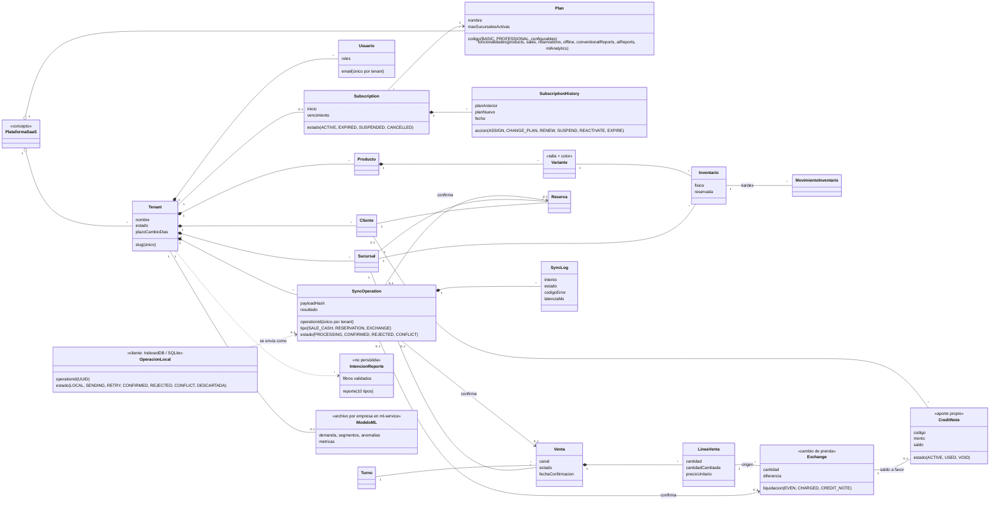

Reglas del dominio:

- `Usuario.tenant` es obligatorio salvo para el **administrador de plataforma** (rol
  `PLATFORM_ADMIN`), que no pertenece a ninguna empresa.
- Los nombres únicos del parcial 1 (categoría, talla, color, proveedor, sucursal por ciudad, email)
  pasan a ser únicos **dentro** de cada tenant.
- Una empresa tiene **una** suscripción; los cambios (asignar, cambiar plan, renovar, suspender,
  reactivar, vencer) quedan en `SubscriptionHistory`.
- Los límites y funcionalidades viven en `Plan` (datos configurables por la plataforma), no en el código.
- `SyncOperation.operationId` es único por tenant: es la clave de idempotencia (RNF05). El cliente
  conserva su `OperacionLocal` aunque el servidor la confirme o rechace (RNF03, RNF06).
- Una línea de venta solo puede cambiarse hasta su cantidad (`cantidadCambiada ≤ cantidad`) y dentro
  del plazo de la empresa (`plazoCambioDias`, 0 a 365).

## 2. Modelo de casos de uso

Actores: **Administrador de plataforma**, **Administrador de empresa** (rol `ADMINISTRATOR` del
parcial 1, ahora acotado a su tenant), **Encargado de sucursal**, **Cajero**, **Cliente** y
**Servicio ML** (actor sistema, consultado por el backend).

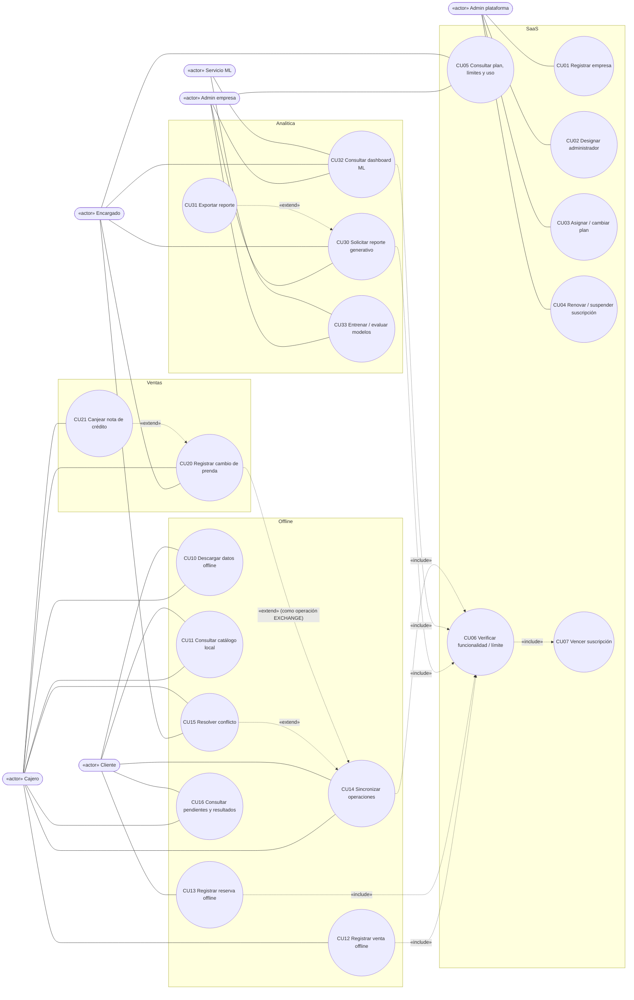

CU07 no tiene actor: el vencimiento se detecta y registra (`EXPIRE`) la primera vez que una
petición de la empresa verifica la suscripción después de la fecha de vencimiento (CU06).

Casos del parcial 1 que se **modifican**: iniciar sesión (ahora por empresa), registrar cliente
(por empresa), CRUD de sucursales (límite del plan), toda escritura de negocio (bloqueada en solo
lectura), reportes convencionales, POS, reservas y catálogo (restringidos al tenant y a las
funcionalidades del plan).

## 3. Descripción de casos de uso críticos

### CU01 Registrar empresa
- **Actor:** Admin plataforma. **Precondición:** sesión de plataforma (`POST /platform/auth/login`).
- **Flujo básico:** 1) El admin abre "Empresas" y elige "Nueva". 2) Ingresa nombre, slug, plan y
  datos del administrador de empresa. 3) El sistema valida que el slug no exista y que el plan esté
  activo. 4) Crea el tenant, su suscripción `ACTIVE`, el historial `ASSIGN` y el usuario
  administrador con rol `ADMINISTRATOR` dentro del tenant, en una transacción. 5) Muestra la empresa
  con su estado y uso.
- **Alternativos:** 3a) Slug repetido → 409. 3b) Plan inexistente o inactivo → error de validación.
  4a) Falla cualquier paso → se revierte todo (transacción).

### CU03 Asignar / cambiar plan
- **Actor:** Admin plataforma.
- **Flujo básico:** 1) Selecciona empresa y nuevo plan. 2) El sistema compara el uso actual con los
  límites del nuevo plan (sucursales activas). 3) Actualiza la suscripción y agrega `CHANGE_PLAN`
  al historial. 4) Las funcionalidades se habilitan o deshabilitan en la petición siguiente.
- **Alternativos:** 2a) El uso excede el nuevo límite → 409 `PLAN_LIMIT_EXCEEDED`.

### CU12 Registrar venta offline
- **Actor:** Cajero. **Precondición:** turno abierto con conexión y datos de la sucursal descargados
  (CU10).
- **Flujo básico:** 1) Sin conexión, el cajero busca productos en el catálogo local. 2) Elige
  variantes y cantidades; la cantidad se limita al **stock conocido** (descargado menos lo ya
  vendido o reservado localmente). 3) Registra el efectivo recibido. 4) El sistema guarda la venta
  local con `operationId` UUID, empresa, sucursal, usuario, cliente opcional, fecha local, líneas con
  precios usados, total, forma de pago, hash del contenido y estado `LOCAL`. 5) Muestra el ticket
  "pendiente de confirmación del servidor".
- **Alternativos:** 1a) Datos con más de 12 h → aviso de datos desactualizados. 2a) Doble clic →
  una sola venta (candado). 4a) Cierre de la app → la venta permanece en IndexedDB / SQLite (RNF03).

### CU13 Registrar reserva offline
- **Actor:** Cliente.
- **Flujo básico:** 1) Consulta productos locales de su tienda. 2) Elige sucursal, variantes y
  horario aproximado. 3) Se guarda la reserva local con `operationId` y estado `LOCAL`. 4) Se informa
  que la reserva será confirmada al sincronizar.
- **Alternativos:** 2a) Sucursal no descargada → no se puede elegir.

### CU14 Sincronizar operaciones
- **Actor:** Cajero / Cliente (o automático al recuperar conexión y cada 30 s).
- **Flujo básico:** 1) El cliente toma el candado de sincronización, marca y **persiste** las
  operaciones `LOCAL`/`RETRY` como `SENDING` y envía lotes a `POST /sync/operations`. 2) El backend
  resuelve la empresa del JWT y verifica rol y funcionalidad `offline`. 3) Por cada operación busca su
  `operationId`: si ya está `CONFIRMED` o `REJECTED` devuelve el resultado guardado (idempotencia).
  4) Si es nueva o quedó en conflicto, la confirma con los servicios existentes (misma transacción,
  inventario y kardex que online). 5) Registra un `SyncLog` por intento. 6) El cliente actualiza cada
  operación al estado devuelto; **nunca la borra**.
- **Alternativos:** 2a) Suscripción vencida → cada operación `CONFLICT` `SUBSCRIPTION_INVALID`.
  3a) Mismo `operationId` con otro contenido → `REJECTED` `OPERATION_ID_REUSED`. 4a) Stock
  insuficiente, precio distinto, variante inactiva, turno cerrado → `CONFLICT` con código y detalle.
  4b) Datos inválidos o hash alterado → `REJECTED`. 1a) Error de red o 5xx → `RETRY` con espera
  creciente de 5 s a 5 min (RNF06).

### CU15 Resolver conflicto
- **Actor:** Cajero / Encargado.
- **Flujo básico:** 1) Abre "Pendientes" y filtra `CONFLICT`. 2) Ve el código y su explicación
  (p. ej. "stock insuficiente"). 3) Elige **reintentar** (reenvía la misma operación, útil cuando la
  causa se resolvió: turno abierto, stock repuesto, suscripción renovada) o **descartar** (queda
  `DESCARTADA`, visible y sin borrar).

### CU20 Registrar cambio de prenda
- **Actor:** Cajero / Encargado.
- **Flujo básico:** 1) Busca la venta original. 2) El sistema verifica que esté completada y dentro
  del plazo de la empresa. 3) Selecciona la línea y la cantidad a cambiar y la nueva variante (misma
  u otra prenda). 4) Calcula la diferencia: igual (`EVEN`), cobro en efectivo al turno (`CHARGED`) o
  saldo a favor como nota de crédito (`CREDIT_NOTE`). 5) En una transacción devuelve la prenda al
  stock, descuenta la nueva, registra ambos movimientos en el kardex y el cambio.
- **Alternativos:** 2a) Fuera de plazo → `EXCHANGE_WINDOW_EXPIRED`. 3a) Cantidad ya cambiada →
  `ALREADY_EXCHANGED`. 3b) Sin stock → `STOCK_INSUFFICIENT`. 4a) Cobro sin turno abierto →
  `SHIFT_REQUIRED`. 1a) Sin conexión → operación `EXCHANGE` que sigue CU14.

### CU30 Solicitar reporte generativo
- **Actor:** Admin empresa / Encargado (web o móvil). **Precondición:** plan con `aiReports`.
- **Flujo básico:** 1) Escribe o dicta la solicitud (Web Speech API en la web; dictado del teclado en el móvil). 2) El backend descarta pedidos prohibidos
  (escrituras, datos personales, otras empresas, SQL). 3) Pide a la IA **solo** una intención JSON y
  la valida contra los 10 reportes y los filtros permitidos (ids de sucursales, categorías y
  productos de la empresa). 4) Ejecuta la consulta parametrizada predefinida, restringida al tenant y
  a la sucursal del encargado. 5) Devuelve tabla tipada, especificación de gráfico elegida según los
  datos y narrativa. 6) La UI muestra el gráfico y la tabla y permite exportar (CU31).
- **Alternativos:** 0a) Plan sin `aiReports` → 403 `PLAN_FEATURE_REQUIRED`. 3a) Ambigua →
  `NEEDS_CLARIFICATION` con sugerencias. 3b) No soportada → `UNSUPPORTED` con lo que sí se puede.
  3c) IA no disponible → reglas de respaldo en español.

### CU32 Consultar dashboard ML
- **Actor:** Admin empresa / Encargado. **Precondición:** plan con `mlAnalytics`.
- **Flujo básico:** 1) Abre "Analítica ML". 2) El backend verifica rol y plan y consulta al servicio
  ML, siempre con la empresa del JWT: métricas, predicción de demanda, segmentos y anomalías. 3) Le
  agrega nombres de productos y sucursales y, para el encargado, filtra su sucursal. 4) La UI muestra
  KPIs, gráficos, tablas y la evaluación de los modelos, indicando si los datos son sintéticos.
- **Alternativos:** 2a) Modelos no entrenados → "Sin modelos entrenados". 2b) Servicio caído → 503
  `ML_UNAVAILABLE`. 2c) Una parte sin datos suficientes → se muestra el motivo.

### CU33 Entrenar / evaluar modelos
- **Actor:** Admin empresa. **Precondición:** plan con `mlAnalytics`.
- **Flujo básico:** 1) Elige "datos sintéticos" o "ventas reales". 2) El backend arma el catálogo
  (sintético) o los agregados semanales y compras sin datos personales (real) de su empresa.
  3) El servicio ML entrena demanda, segmentación y anomalías, los evalúa y guarda el modelo de la
  empresa. 4) Se muestra qué partes quedaron entrenadas.
- **Alternativos:** 2a) Sin ventas → `ML_INSUFFICIENT_DATA`. 1a) Ya hay un entrenamiento en curso →
  `ML_TRAINING_IN_PROGRESS`.

## 4. Diagramas de robustez

Reglas ICONIX respetadas: los actores solo hablan con *boundaries*; los *boundaries* solo con
*controls*; las *entities* solo con *controls*.

### 4.1 CU01 Registrar empresa

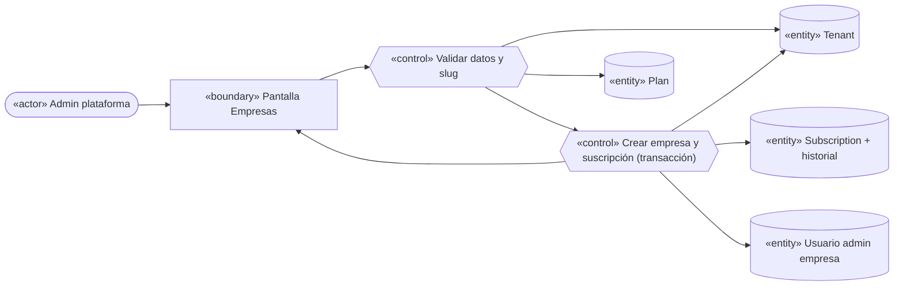

### 4.2 CU03 Cambiar plan

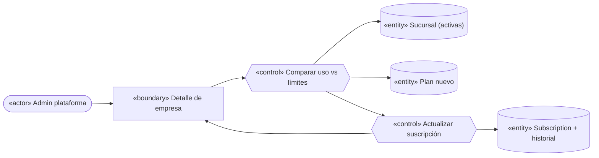

### 4.3 CU12 Venta offline y CU13 Reserva offline (cliente)


### 4.4 CU14 Sincronizar operaciones

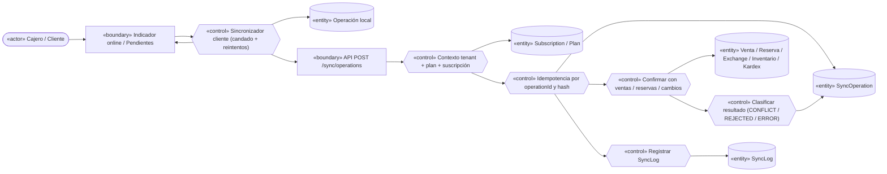

### 4.5 CU15 Resolver conflicto

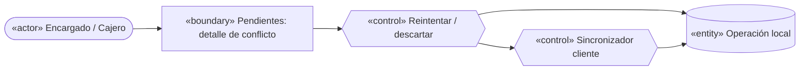

### 4.6 CU20 Cambio de prenda

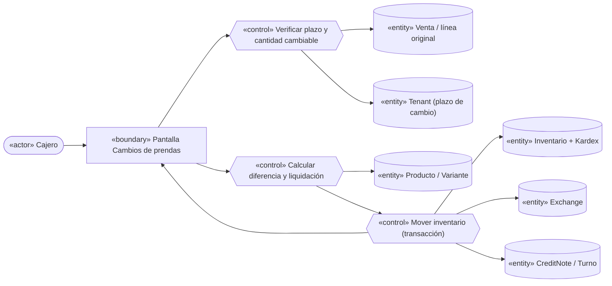

### 4.7 CU30 Reporte generativo

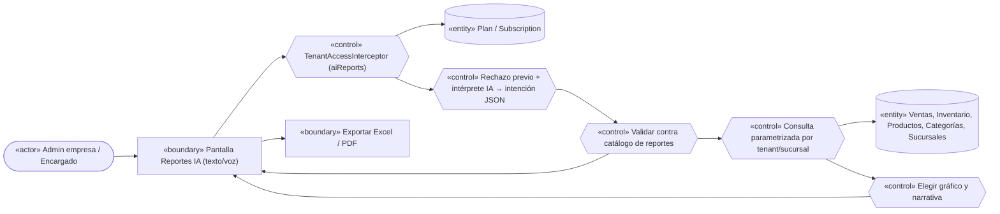

### 4.8 CU32 Dashboard ML y CU33 Entrenar

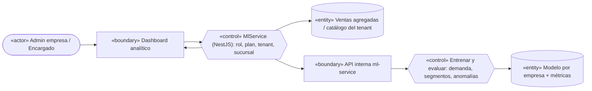

### 4.9 Cambios del análisis a la implementación (revisión F12)

| Elemento del análisis (F1) | Implementación | Motivo |
|---|---|---|
| `Tenant 1–* Subscription` (historial como suscripciones) | `Tenant 1–0..1 Subscription` + `SubscriptionHistory` | Una sola suscripción vigente; el historial guarda acciones y planes |
| `ReportRequest` persistido | `IntencionReporte` no persistida | El reporte se recalcula siempre con datos actuales; no hay requisito de historial |
| `MLModel` en la base | Archivo `joblib` por empresa dentro de ml-service | El servicio no accede a la BD (decisión 3.7); el modelo es un artefacto binario |
| Estados `SyncOperation` = estados del cliente | Servidor: `PROCESSING/CONFIRMED/REJECTED/CONFLICT`; cliente agrega `LOCAL/SENDING/RETRY/DESCARTADA` | Los estados de transmisión solo existen en el dispositivo |
| CU12 2a: vender por encima del stock con advertencia | La cantidad se limita al stock conocido | Evita conflictos seguros; el servidor igual revalida al sincronizar |
| CU15: ajustar y reenviar como nueva operación | Reintentar la misma operación o descartarla | Una operación ajustada sería otra venta; se registra de nuevo si hace falta |
| CU07 disparado por "Reloj del sistema" | Detección al verificar la suscripción (perezosa) | Sin jobs extra; el resultado es el mismo para cada petición |
| `PlanGuard` | `TenantAccessInterceptor` | Un guard global corría antes del JWT y no conocía la empresa del usuario |
| CU32 2a: KPIs propios si ML cae | 503 `ML_UNAVAILABLE` con reintento | Los KPIs convencionales ya están en "Reportes" |
| Cambio de prenda sin saldo a favor | `CreditNote` con canje parcial (aporte propio, CU21) | F7.3 |
| Banderas `products`, `sales`, `reservations` | Verificadas en todos los módulos (F10.4) | Se detectó en la auditoría de rutas que solo se configuraban |

---

## 5. Diagramas de secuencia

Se derivan de los diagramas de robustez: cada *boundary* y *control* pasa a ser una clase o función
real (nombres del código). Para no repetir, el paso común "petición con empresa" se detalla una vez
en 5.1.

### 5.1 Petición autenticada con empresa (común a todos los casos)

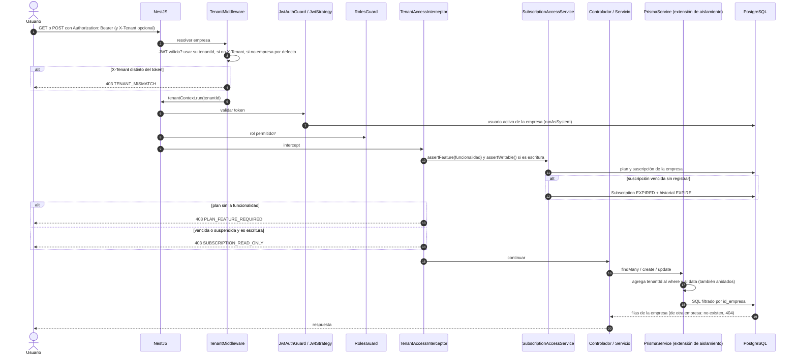

### 5.2 CU01 Registrar empresa

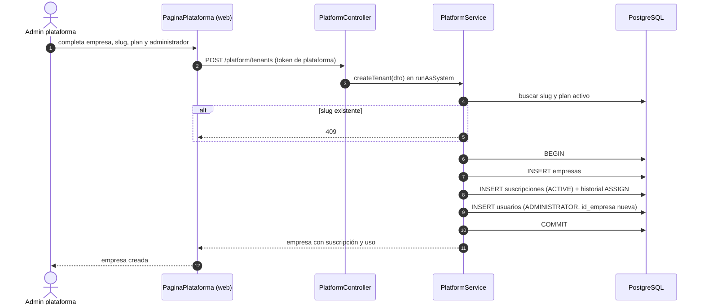

### 5.3 CU03 Cambiar plan

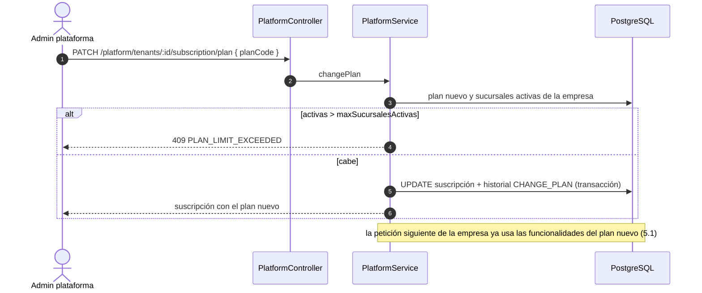

### 5.4 CU12 Venta offline y CU14 sincronización (PWA)

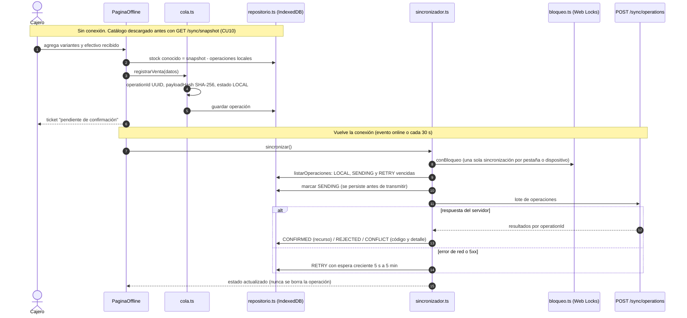

### 5.5 CU14 Sincronización en el servidor (idempotencia)

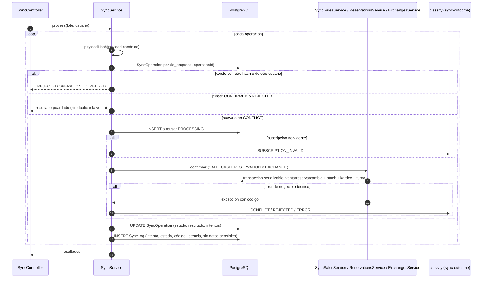

### 5.6 CU20 Cambio de prenda

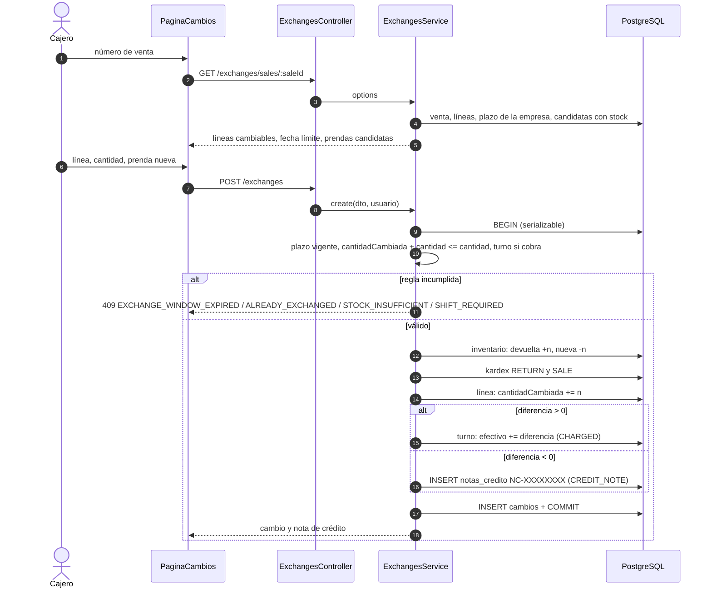

### 5.7 CU30 Reporte generativo

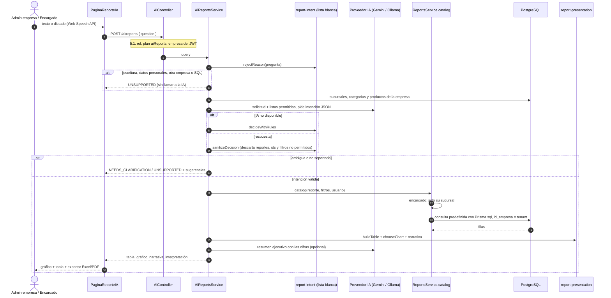

### 5.8 CU33 Entrenar y CU32 Consultar dashboard ML

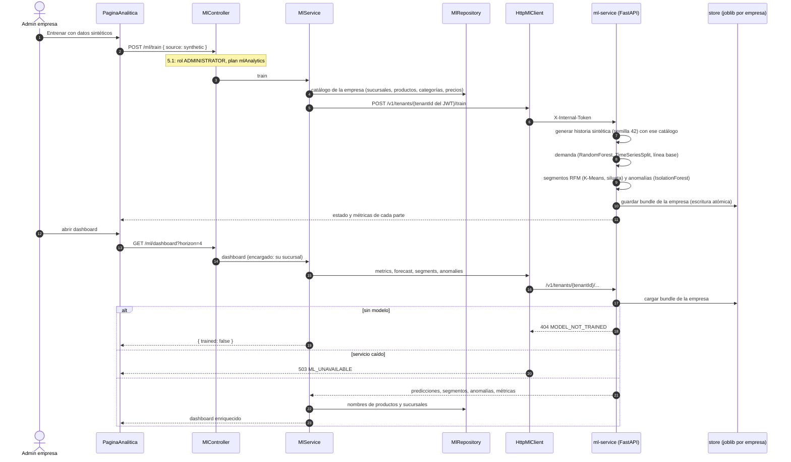

---

## 6. Diagrama de clases de diseño y modelo de datos

### 6.1 Backend: multitenancy, planes y plataforma

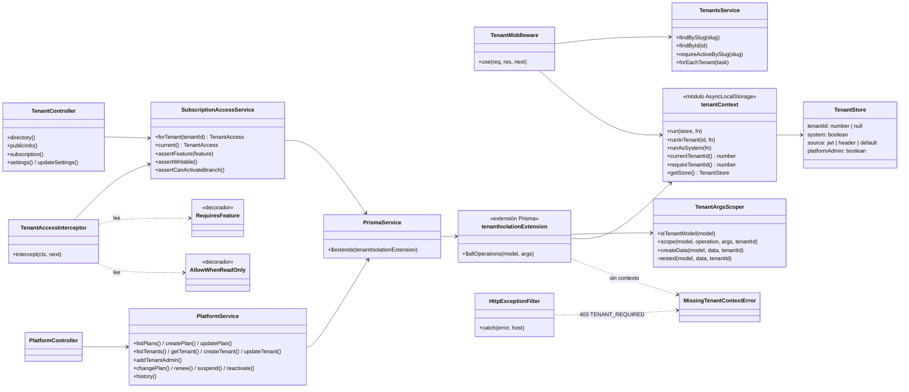

### 6.2 Backend: sincronización y cambios de prendas

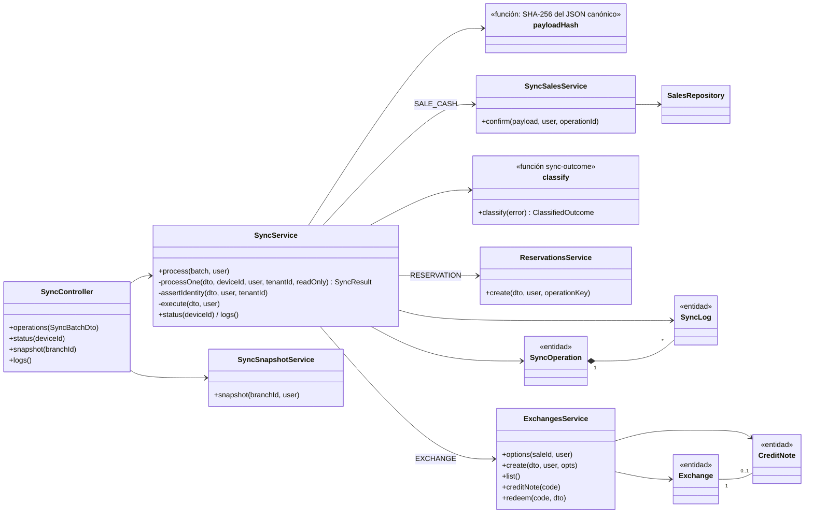

### 6.3 Backend: reportes generativos y Machine Learning

```mermaid
classDiagram
  direction LR
  class AiController {
    +report(AiReportQueryDto)
  }
  class AiReportsService {
    +query(dto, user)
    -run(intent, user)
    -notAnswered(dto, source, decision)
  }
  class AiProvider {
    <<interfaz>>
    +name
    +model
    +generateJson(request)
  }
  class GeminiProvider
  class OllamaProvider
  class reportIntent {
    <<módulo report-intent>>
    +REPORT_KINDS
    +rejectReason(q)
    +sanitizeDecision(output, branches, catalog)
    +decideWithRules(q, branches, today, catalog)
  }
  class reportPresentation {
    <<módulo report-presentation>>
    +buildTable(intent, result) ReportTable
    +chooseChart(intent, table) ChartSpec
    +summarizeCatalog(intent, result, table)
  }
  class ReportsService {
    +catalog(report, filters, user)
    +sales() / inventory() / cashShifts() / reservations()
    -scopedMany(filters, user)
  }
  class ReportsRepository {
    -salesLines(filters, period)
    +salesGrouped() / catalogTopProducts() / topCategories()
    +branchComparison() / lowStock()
  }
  class MlController {
    +train(TrainMlDto)
    +dashboard(MlDashboardQueryDto)
  }
  class MlService {
    +train(dto, user)
    +dashboard(query, user)
    -scope(user, branchId)
  }
  class MlClient {
    <<interfaz>>
    +request(method, path, body)
  }
  class HttpMlClient
  class MlRepository {
    +catalogShape()
    +weeklySales()
    +transactions()
    +names(productIds, branchIds)
  }

  AiController --> AiReportsService
  AiReportsService --> AiProvider
  AiProvider <|.. GeminiProvider
  AiProvider <|.. OllamaProvider
  AiReportsService --> reportIntent
  AiReportsService --> reportPresentation
  AiReportsService --> ReportsService
  ReportsService --> ReportsRepository
  MlController --> MlService
  MlService --> MlClient
  MlClient <|.. HttpMlClient
  MlService --> MlRepository
```

### 6.4 ml-service (Python)

```mermaid
classDiagram
  direction LR
  class main {
    <<FastAPI>>
    +health()
    +train(tenant_id, TrainRequest)
    +metrics(tenant_id)
    +forecast(tenant_id, ForecastRequest)
    +segments(tenant_id)
    +anomaly_weeks(tenant_id)
    -require_token(X-Internal-Token)
  }
  class training {
    +train_tenant(tenant_id, req) dict
  }
  class synthetic {
    +generate(seed, weeks, customers, catalog) SyntheticData
  }
  class Catalog {
    branches
    products
  }
  class SyntheticData {
    sales: DataFrame
    transactions: DataFrame
    anomalies
    customer_profiles
  }
  class features {
    +NUMERIC / CATEGORICAL
    +training_frame(sales)
    +add_features(sales)
  }
  class DemandModel {
    pipeline: RandomForestRegressor
    history
    metrics
    +forecast(horizon, products, branches)
  }
  class Segmentation {
    assignments
    summary
    metrics
  }
  class AnomalyResult {
    weeks
    metrics
    +flagged()
  }
  class store {
    +save(tenant_id, bundle)
    +load(tenant_id)
  }

  main --> training
  main --> store
  training --> synthetic
  synthetic --> Catalog
  synthetic --> SyntheticData
  training --> DemandModel : demand.train
  training --> Segmentation : segmentation.train
  training --> AnomalyResult : anomalies.detect
  DemandModel --> features
  training --> store
```

### 6.5 Clientes offline (PWA y móvil)

Ambos clientes comparten el contrato `/sync/operations` y las mismas reglas (estados, reintentos,
no borrar). Cambia el almacenamiento: IndexedDB en la PWA y SQLite (`expo-sqlite`) en el móvil.

```mermaid
classDiagram
  direction LR
  class OperacionLocal {
    operationId
    tipo
    tenantId
    userId
    alcance
    payload
    payloadHash
    estado
    intentos
    siguienteIntento
    resultado
  }
  class repositorio_web {
    <<IndexedDB src/offline>>
    +guardarSnapshot() / leerSnapshot()
    +listarOperaciones(alcance)
    +guardarOperaciones(ops)
    +stockLocal(snapshot, ops, variante)
  }
  class cola_web {
    +registrarVenta() / registrarReserva() / registrarCambio()
  }
  class sincronizador_web {
    +sincronizar(alcance, incluir)
    +reintentar(alcance, operationId)
    +descartar(op)
    +esperaReintento(intentos)
  }
  class bloqueo {
    +conBloqueo(fn) Web Locks o respaldo en memoria
  }
  class migracion {
    +migrarLegado() localStorage a IndexedDB
  }
  class BaseDatos {
    <<interfaz móvil, tipos.ts>>
    +ejecutar(sql)
    +correr(sql, params)
    +todos(sql, params)
    +primero(sql, params)
    +transaccion(fn)
  }
  class nucleo_movil {
    <<src/offline/nucleo.ts>>
    +migrar(db) PRAGMA user_version
    +guardarSnapshot() / catalogo()
    +registrar() / aEnvio() / sincronizar() / descartar()
  }
  class sqlite_expo {
    <<expo-sqlite>>
  }
  class sqlite_node {
    <<node:sqlite, pruebas>>
  }

  cola_web --> repositorio_web
  sincronizador_web --> repositorio_web
  sincronizador_web --> bloqueo
  migracion --> repositorio_web
  repositorio_web --> OperacionLocal
  nucleo_movil --> BaseDatos
  BaseDatos <|.. sqlite_expo
  BaseDatos <|.. sqlite_node
  nucleo_movil --> OperacionLocal
```

### 6.6 Modelo de datos (tablas nuevas y columna de empresa)

Nombres físicos de PostgreSQL. `id_empresa` se agregó a las 29 tablas de negocio del parcial 1 con
índice propio y `DEFAULT current_setting('app.tenant_id')`, que falla si la aplicación no fija la
empresa. Solo se muestran las tablas nuevas y dos tablas existentes como ejemplo.

```mermaid
erDiagram
  empresas ||--o| suscripciones : tiene
  planes ||--o{ suscripciones : "asignado en"
  suscripciones ||--o{ historial_suscripciones : registra
  empresas ||--o{ operaciones_sync : recibe
  operaciones_sync ||--o{ sync_log : "intentos"
  empresas ||--o{ ventas : "id_empresa"
  ventas ||--o{ detalles_venta : contiene
  detalles_venta ||--o{ cambios : "origen"
  cambios ||--o| notas_credito : genera
  empresas ||--o{ cambios : "id_empresa"
  empresas ||--o{ notas_credito : "id_empresa"

  empresas {
    int id_empresa PK
    varchar slug UK
    varchar nombre
    enum estado
    int plazo_cambio_dias "0 a 365"
  }
  planes {
    int id_plan PK
    varchar codigo UK
    int max_sucursales_activas
    jsonb funcionalidades
    numeric precio_mensual
    bool activo
  }
  suscripciones {
    int id_suscripcion PK
    int id_empresa FK "UK"
    int id_plan FK
    timestamptz fecha_inicio
    timestamptz fecha_vencimiento
    enum estado
  }
  historial_suscripciones {
    int id PK
    int id_suscripcion FK
    enum accion
    int id_plan_anterior FK
    int id_plan_nuevo FK
  }
  operaciones_sync {
    int id_operacion_sync PK
    int id_empresa FK
    uuid id_operacion "UK con id_empresa"
    varchar id_dispositivo
    int id_usuario FK
    enum tipo
    enum estado
    jsonb datos
    varchar hash_datos
    int intentos
    varchar codigo_resultado
    varchar tipo_recurso
    int id_recurso
  }
  sync_log {
    int id PK
    int id_operacion_sync FK
    int intento
    enum estado
    varchar codigo_error
    int latencia_ms
  }
  ventas {
    int id_venta PK
    int id_empresa FK
    int id_sucursal FK
    enum estado
    timestamptz fecha_confirmacion "indice con id_empresa y estado"
    uuid id_lote_offline
  }
  detalles_venta {
    int id_detalle_venta PK
    int id_venta FK
    int cantidad
    int cantidad_cambiada "CHECK <= cantidad"
  }
  cambios {
    int id_cambio PK
    int id_empresa FK
    int id_detalle_venta FK
    uuid clave_operacion "UK con id_empresa"
    int cantidad
    numeric diferencia
    enum liquidacion
  }
  notas_credito {
    int id PK
    int id_empresa FK
    varchar codigo "UK con id_empresa"
    numeric monto
    numeric saldo "CHECK <= monto"
    enum estado
  }
```

Migraciones del parcial 2: `20261027000000_multitenancy`, `20261028000000_sync_operations`,
`20261029000000_exchanges` y `20261030000000_report_indexes`.

---

## 7. Componentes y despliegue

### 7.1 Diagrama de componentes

```mermaid
flowchart LR
  subgraph PWA["«component» Web React + Vite (PWA)"]
    UIW["«component» Páginas: tienda, panel, caja, plataforma, reportes IA, analítica"]
    OFW["«component» src/offline: repositorio, cola, sincronizador"]
    SW["«component» Service Worker (Workbox)"]
    IDB[("«artifact» IndexedDB")]
    UIW --> OFW --> IDB
  end
  subgraph MOV["«component» Móvil React Native + Expo SDK 57"]
    UIM["«component» Pantallas cliente y modo vendedor"]
    OFM["«component» src/offline/nucleo"]
    SQL[("«artifact» SQLite (expo-sqlite)")]
    UIM --> OFM --> SQL
  end
  subgraph API["«component» API NestJS"]
    TEN["«component» Tenancy + Platform"]
    BUS["«component» Catálogo, inventario, ventas, reservas, caja, pagos"]
    SYN["«component» Sync"]
    EXC["«component» Exchanges"]
    AIR["«component» AI (reportes generativos)"]
    MLM["«component» ML (cliente del servicio)"]
    PRI["«component» Prisma + extensión de aislamiento"]
    TEN --> PRI
    BUS --> PRI
    SYN --> BUS
    SYN --> EXC
    EXC --> PRI
    AIR --> PRI
    MLM --> PRI
  end
  MLS["«component» ml-service FastAPI + scikit-learn"]
  DB[("«component» PostgreSQL")]
  LLM["«component» Gemini API u Ollama"]
  STR["«component» Stripe, Firebase, Cloudinary"]

  UIW -- "REST /api/v1 (JWT, X-Tenant)" --> API
  OFW -- "/sync/snapshot, /sync/operations" --> SYN
  OFM -- "/sync/snapshot, /sync/operations" --> SYN
  UIM -- "REST /api/v1" --> API
  PRI --> DB
  AIR -- "intención JSON" --> LLM
  MLM -- "HTTP interno + X-Internal-Token" --> MLS
  BUS --> STR
```

Interfaces que se comparten: el contrato `/sync/*` (web y móvil), los códigos de error estables
(`code`) y el header `X-Tenant`. El servicio ML no tiene acceso a la base de datos.

### 7.2 Diagrama de despliegue (objetivo de F11)

> El despliegue del parcial 1 está en `docs/despliegue-azure.md`. La nueva versión se publicará en
> F11, cuando el equipo disponga de créditos de Azure; este diagrama describe el objetivo, sin
> nombres de recursos.

```mermaid
flowchart TB
  subgraph Cliente1["«device» Navegador (PC o móvil)"]
    B["«executionEnvironment» Chrome / Edge / Firefox"]
    BA["«artifact» PWA instalada + Service Worker + IndexedDB"]
    B --- BA
  end
  subgraph Cliente2["«device» Teléfono Android"]
    AA["«artifact» APK FashionStore (Expo SDK 57) + SQLite"]
  end
  subgraph Azure["«device» Azure (suscripción del equipo)"]
    subgraph CAE["«executionEnvironment» Entorno de Container Apps (único)"]
      FE["«artifact» Contenedor frontend (nginx + build Vite), ingreso externo HTTPS"]
      BE["«artifact» Contenedor backend NestJS, ingreso externo HTTPS"]
      MLC["«artifact» Contenedor ml-service, ingreso INTERNO, volumen de modelos"]
    end
    PG[("«executionEnvironment» Azure Database for PostgreSQL Flexible Server")]
    ACR["«artifact» Azure Container Registry (imágenes construidas en local)"]
  end
  EXT["«device» Servicios externos: Gemini, Stripe, Firebase"]

  B -- "HTTPS" --> FE
  B -- "HTTPS /api/v1" --> BE
  AA -- "HTTPS /api/v1" --> BE
  BE -- "TCP 5432 (TLS)" --> PG
  BE -- "HTTP interno" --> MLC
  BE -- "HTTPS" --> EXT
  ACR -. "imágenes" .-> CAE
```

Para desarrollo local, `docker-compose.yml` levanta `db`, `backend`, `frontend` y `ml` (este último
sin puertos publicados, solo en la red de compose).

---

## 8. Matriz de trazabilidad

Requisito del enunciado → caso de uso → diseño (clases, endpoints, pantallas) → pruebas
automatizadas. Rutas de pruebas: backend `backend/src/**/*.spec.ts` y `backend/test/*.e2e-spec.ts`;
web `frontend/test/`; móvil `mobile/test/`; ML `ml-service/tests/`.

### 8.1 Requisitos funcionales (desafíos)

| Requisito (enunciado) | CU | Diseño / implementación | Pruebas |
|---|---|---|---|
| I. ICONIX sobre lo nuevo | todos | Este documento (§1–8) | — (revisión documental) |
| II. PWA instalable, recursos offline | CU10, CU11 | `vite-plugin-pwa`, `src/offline/db.ts`, `GET /sync/snapshot` | `pwa.test.ts`, `offline-sync.test.ts`; Playwright F5.7 (manual documentado) |
| II/III. Consultar catálogo y precios offline, aviso de datos viejos | CU11 | `PaginaTiendaOffline`, `PantallaTiendaOffline`, `componentes.tsx` | `offline-ui.test.tsx`, `offline-movil.test.mjs` |
| II/III/IV. Venta de contado offline con todos los campos | CU12 | `cola.ts`, `PaginaOffline`, `PantallaVender`, `SaleCashPayloadDto` | `offline-ui.test.tsx`, `offline-sync.test.ts`, `offline-movil.test.mjs`, `sync.e2e-spec.ts` |
| II/III. Reserva offline | CU13 | `registrarReserva`, `ReservationPayloadDto` | `offline-sync.test.ts`, `sync.e2e-spec.ts` |
| II/III. Pendientes, resultados, conservar al reiniciar | CU16 | `PaginaPendientes`, `PantallaPendientes`, IndexedDB / SQLite | `offline-ui.test.tsx` (cerrar y reabrir), `offline-movil.test.mjs` (reabrir archivo) |
| II/III. Sincronización con estados, reintentos, sin duplicar | CU14 | `sincronizador.ts`, `nucleo.ts`, `SyncService`, `SyncOperation` | `offline-sync.test.ts`, `sync.e2e-spec.ts`, `sync-outcome.spec.ts` |
| IV. Conflictos de inventario | CU15 | `classify`, `PaginaPendientes` | `sync.e2e-spec.ts`, `exchanges.e2e-spec.ts` (venta offline vs online por la última unidad) |
| IV. Cambios de prendas en un plazo | CU20 | `ExchangesService`, `/exchanges`, `PaginaCambios`, operación `EXCHANGE` | `exchanges.e2e-spec.ts` (plazo, doble cambio concurrente, kardex) |
| IV. Aporte propio | CU21 | `CreditNote`, `/credit-notes/:code/redeem` | `exchanges.e2e-spec.ts` |
| V. Reportes por texto y voz, ≥4 tipos, filtros, multi-tabla | CU30 | `AiReportsService`, `report-intent.ts`, `ReportsService.catalog`, `PaginaReporteIA` (web), `PantallaReportesIA` (móvil) | `report-intent.spec.ts`, `ai.e2e-spec.ts`, `reporte-ia.test.tsx`, `mobile/test/reportes-ia.test.mjs` |
| V. Tabla o gráfico, exportar Excel/PDF | CU30, CU31 | `report-presentation.ts`, `GraficoDinamico`, `datos-exportacion.ts` | `reporte-ia.test.tsx`, `exportacion-*.test.ts(x)` |
| V. Ambiguas, incompletas o no soportadas; sin consultas arbitrarias | CU30 | `rejectReason`, `sanitizeDecision`, lista blanca | `report-intent.spec.ts`, `ai.e2e-spec.ts` |
| V. ML: datos sintéticos, supervisado, no supervisado, evaluación | CU33 | `ml-service/app/{synthetic,features,demand,segmentation,anomalies}.py` | `ml-service/tests/test_models.py`, `test_synthetic.py` |
| V. Integración ML y dashboard | CU32, CU33 | `MlService`, `HttpMlClient`, `PaginaAnalitica` | `ml.e2e-spec.ts`, `ml-service/tests/test_api.py`, `analitica.test.tsx` |
| VI. Empresas, ≥2 tenants | CU01, CU02 | `PlatformService`, seed `tenant-b.ts` | `tenancy.e2e-spec.ts` |
| VI. Planes configurables, límites y funcionalidades | CU03, CU05, CU06 | `planes.funcionalidades`, `SubscriptionAccessService`, `TenantAccessInterceptor` | `tenancy.e2e-spec.ts` (límite de sucursales, plan sin reservas), `route-access.spec.ts`, `saas.test.tsx` |
| VI. Suscripción: asignar, renovar, vencer, restringir | CU03, CU04, CU07 | `SubscriptionHistory`, modo solo lectura | `tenancy.e2e-spec.ts` (vencida = solo lectura), `ai.e2e-spec.ts` (reportes en solo lectura) |
| VI. Seguridad multitenant en backend | CU06 | `TenantMiddleware`, extensión de aislamiento, `$queryRaw` con `id_empresa` | `tenancy.e2e-spec.ts` (404 entre empresas, `TENANT_MISMATCH`), `tenant-isolation.extension.spec.ts`, `raw-sql.spec.ts`, `ai.e2e-spec.ts` (ventas de otra empresa excluidas), `ml-service/tests/test_api.py` |

### 8.2 Requisitos no funcionales

| RNF | Cómo se cumple | Evidencia |
|---|---|---|
| RNF01 Seguridad | JWT por empresa, `RolesGuard`, rutas públicas revisadas, token interno para ML, errores sin detalle interno | `route-access.spec.ts`, `http-exception.filter.spec.ts`, `roles.guard.spec.ts` |
| RNF02 Aislamiento | Extensión de Prisma (falla cerrada), default de BD que exige empresa, filtros en SQL crudo, modelo ML por empresa | `tenancy.e2e-spec.ts`, `tenant-isolation.extension.spec.ts`, `raw-sql.spec.ts`, `test_api.py` |
| RNF03 Persistencia offline | IndexedDB y SQLite; nunca se borran operaciones | `offline-ui.test.tsx`, `offline-movil.test.mjs` |
| RNF04 Integridad transaccional | Venta, pago, turno, stock y kardex en una transacción serializable; CHECKs en BD | `sales.e2e-spec.ts`, `exchanges.e2e-spec.ts`, `sync.e2e-spec.ts` |
| RNF05 Idempotencia | `operationId` único por empresa + hash; `idempotencyKey` y `operationKey` en dominio | `sync.e2e-spec.ts` (reenvío no duplica, id reutilizado) |
| RNF06 Recuperación | `RETRY` con espera creciente, `SENDING` persistido antes de enviar, recuperación tras error | `offline-sync.test.ts`, `sync.e2e-spec.ts` |
| RNF07 Mantenibilidad | Capas: páginas / servicios / repositorios / sincronizador; núcleo móvil puro con `BaseDatos` inyectada | Estructura de `src/offline` (web y móvil), §6 |
| RNF08 Compatibilidad | PWA en navegadores modernos (Web Locks con respaldo); Expo SDK 57 conserva push, cámara y RA | Playwright (Chromium) F5/F7/F8/F9; `push.test.mjs` |
| RNF09 Rendimiento | Índices por `tenantId`, índice de reportes `(id_empresa, estado, fecha_confirmacion)`, descarga offline acotada, paginación | `schema-indexes.spec.ts`; mediciones en `backend/README.md` |
| RNF10 Observabilidad | `SyncLog` por intento (estado, código, latencia, sin payload); `GET /sync/logs`; logs sin datos de consulta | `sync.e2e-spec.ts`, `http-exception.filter.spec.ts` |
| RNF11 Calidad | Backend 242 unitarias + 144 e2e; web 194; móvil 24; ml-service 12 | `PLAN_PARCIAL2.md` §1.4 |
| RNF12 Coherencia documental | Revisión F12 de §1–4 contra el código (tabla 4.9); §5–8 con nombres reales | Este documento |

---

## 9. Guion de demostración

Duración aproximada: 20 minutos. Preparación: base con seed principal + `npm run prisma:seed:tenant-b`
(contraseñas en `.env`, nunca en el guion), backend, web, `ml-service` y la APK instalada.

1. **Dos empresas y aislamiento (Desafío VI).** Abrir `/empresas`, entrar a FashionStore y a
   Empresa B: catálogos distintos. Con la sesión de A, abrir la URL de un producto de B → 404.
   Mostrar en "Plan y suscripción" el plan Profesional (A) y Básico (B).
2. **Plataforma.** Iniciar sesión en `/plataforma`, crear la Empresa C con plan Básico y su
   administrador; intentar pasar A a Básico → `PLAN_LIMIT_EXCEEDED`.
3. **Plan bloqueando IA.** Con el admin de B, el menú no muestra "Reportes con IA" ni "Analítica
   ML"; forzar la URL → mensaje de plan sin la funcionalidad.
4. **Solo lectura.** Suspender B desde la plataforma: el panel de B muestra el aviso; crear una
   sucursal → `SUBSCRIPTION_READ_ONLY`; consultar sí funciona. Reactivar.
5. **Venta y reserva offline (PWA).** Como cajero de A: abrir turno, descargar datos, poner el
   navegador sin conexión (DevTools), registrar una venta de contado y, como cliente, una reserva.
   Cerrar y reabrir el navegador: siguen en "Pendientes".
6. **Sincronización y conflicto.** Volver a conectar: la venta queda `CONFIRMED` con su número.
   Preparar un conflicto: vender offline la última unidad y venderla online desde otra caja antes de
   reconectar → `CONFLICT STOCK_INSUFFICIENT` con detalle; descartarla (queda visible).
7. **Móvil.** En la APK, modo vendedor: descargar, vender sin conexión, cerrar la app, reabrir y
   sincronizar.
8. **Cambio de prenda.** En "Cambios de prendas", cambiar una prenda de la venta confirmada por otra
   más barata → nota de crédito `NC-…`; mostrar el kardex (RETURN + SALE) y canjear parte de la nota.
9. **Reportes generativos (≥4 tipos).** Pedir por voz o texto: "ventas por sucursal de este mes"
   (barras), "ventas por semana de los últimos 60 días" (líneas), "categorías con mayores ingresos"
   (torta), "compara las sucursales en los últimos 3 meses", "productos con menor existencia".
   Mostrar la interpretación y exportar a Excel y PDF. Pedir "hola" (aclaración) y "borra las ventas
   de ayer" (rechazo). Con el encargado, pedir otra sucursal → se limita a la suya.
10. **Dashboard ML.** Entrenar con datos sintéticos; mostrar predicción con intervalo, segmentos
    RFM con acciones, semanas atípicas y la evaluación (validación cruzada, comparación con líneas
    base, importancia de variables). Intentar con ventas reales → mensaje de datos insuficientes.
11. **Calidad.** Ejecutar `npx vitest run src/common/security` (auditoría de rutas, SQL crudo e
    índices) y mostrar la tabla de rendimiento del README.
